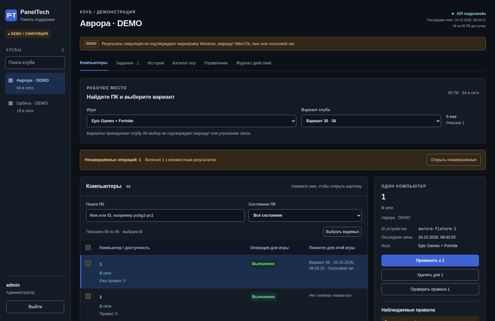
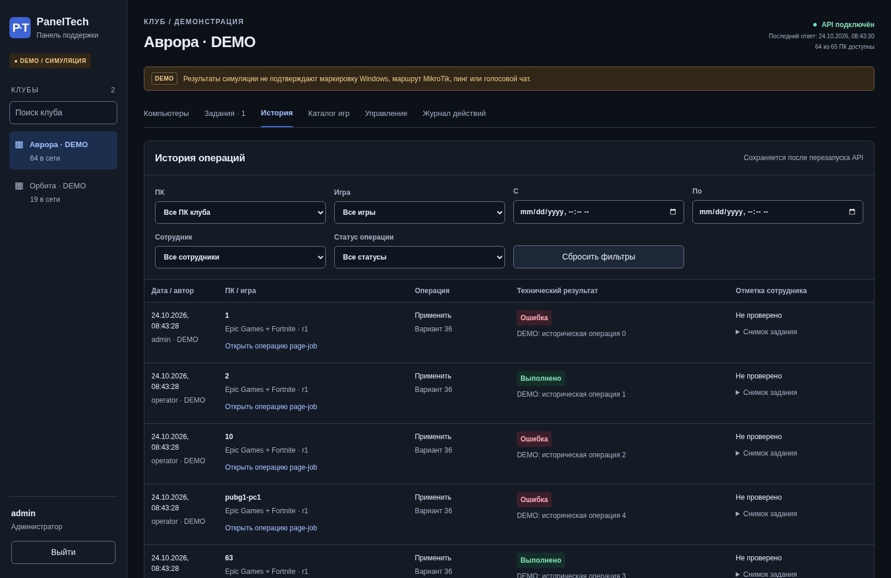

# PanelTech — прототип панели маркировки игр

Рабочая русскоязычная панель поддержки: вход → клуб → выбор ПК и игры → применение/удаление → индивидуальные результаты → история и отметки сотрудников.

**Домашний DEMO работает без Windows, MikroTik, Docker и настоящих клубных ПК. Он не проверяет настоящую маркировку, пинг, маршрут и голосовой чат. Сервис никуда не публикуется.**

Сводка готового и всех оставшихся направлений — [PROJECT-HANDOFF.md](docs/PROJECT-HANDOFF.md), подробные отметки — [TASKS.md](TASKS.md), фактические проверки — [PROJECT-STATUS.md](PROJECT-STATUS.md). Для продолжения в новом чате: [NEW-CHAT-PROMPT.md](NEW-CHAT-PROMPT.md).

## Быстрый запуск

Нужен **Node.js 24 LTS** (проверено 24.19.0, npm 11.9.0). Из корня checkout:

```sh
npm ci
npm run demo
```

После установки зависимостей **одна команда запуска — `npm run demo`**. Она собирает Vue и запускает API, панель и симулятор вместе. Сервер слушает только loopback, порт **3000**. Откройте локально в браузере порт 3000; облачная среда может использовать собственный способ доступа. Публичный туннель не создаётся. Если браузерного доступа к loopback в вашей среде нет, доступны API и headless-проверка Chromium.

| Логин DEMO | Пароль | Роль |
| --- | --- | --- |
| `admin` | `DemoAdmin-2026!` | Каталог, клубы, пользователи, операции |
| `operator` | `DemoOperator-2026!` | Операции, история, отметки |

Это открытые тестовые пароли **только изолированного DEMO**. В режиме пилота они не создаются.

Остановка: Ctrl+C. Повторный запуск сохраняет историю в `.data/demo.sqlite`. Для независимой демонстрации: `DB_PATH=.data/another-demo.sqlite npm run demo`. Порт меняется через `PORT`. `HOST` допускает только loopback. Папки `.data`, `dist`, `node_modules` игнорируются Git. Для работающей базы используйте `db:backup`, учитывающий WAL; не копируйте один активный SQLite-файл. Инструкция — [BACKUP-RESTORE.md](docs/BACKUP-RESTORE.md).

**Автоматические копии включены:** первая при необходимости через минуту после старта, затем каждые 6 часов работы API. По умолчанию сохраняются до 7 проверенных копий с бюджетом 1 ГиБ; последняя пригодная копия остаётся даже при превышении бюджета. Каждая новая копия проходит SHA-256/SQLite и восстановление в отдельную временную БД. Администратору доступна вкладка **«Сервер»** со статусом БД/копий и кнопкой ручного запуска. Расписание работает только при запущенном API; история не удаляется. Формат, каталог, настройки и действия при сбое — [OPERATIONS.md](docs/OPERATIONS.md). Копии на том же носителе не защищают от его поломки; внешнее хранение/шифрование ещё не настроены.

## Личный администратор на вашем ПК

Node.js 24, отдельная папка исходников; далее в терминале:

```sh
npm ci
npm run setup:owner
npm run local
```

Мастер спросит ваш логин и скрытый пароль. Откройте http://127.0.0.1:3000, войдите своими данными и создавайте сотрудников в **Управление → Сотрудники**. Доступны создание/роль/отключение и подтверждённый сброс пароля с отзывом сеансов. Это личные аккаунты для **локальной симуляции**: реальные ПК и внешний доступ отключены. База `.data/local.sqlite` отделена от публичного DEMO; мастер не перезаписывает существующие данные. Для повторного запуска — только `npm run local`.

Подробности Windows/PowerShell, ограничения и проверки — [LOCAL-OWNER.md](docs/LOCAL-OWNER.md). Свой пароль не отправляйте в чат. Текущая версия передаётся в GitHub по отдельному поручению пользователя; Actions остаются приостановлены, проверки выполняются здесь/локально.

## Доступ агентов

Для отдельно настроенной лаборатории администратору доступны запрос смены токена и восстановление существующего ПК по одноразовому файлу. Потерянный ответ регистрации/смены не создаёт второй ПК; при утрате локального состояния требуется явная подготовка, старые файлы сохраняются в карантине, задания и Windows-правила автоматически не восстанавливаются. В домашнем DEMO эти действия отключены. Команды, версии протокола, сроки и ограничения — [AGENT-ACCESS.md](docs/AGENT-ACCESS.md).

## Сохранить и восстановить данные

```sh
npm run db:check -- --db .data/local.sqlite
npm run db:backup -- --db .data/local.sqlite
```

Backup работает без остановки API и выводит путь готового пакета в `.data/backups/`. `db:verify -- --from <путь>` проверяет копию; `db:restore -- --from <путь> --to <новый-файл.sqlite>` восстанавливает в отдельную базу, без перезаписи рабочей. Старые сеансы/агентские доступы отзываются, задания не переисполняются. Перед обновлением базы есть `db:migrate` с обязательным backup. Точные команды, переключение личного DEMO и ограничения — [BACKUP-RESTORE.md](docs/BACKUP-RESTORE.md). Копии содержат конфиденциальные данные, храните их отдельно от исходников и публичных сервисов.

## Экономная база данных

Данные хранятся в SQLite на компьютере с запущенным API (`.data/local.sqlite` для личного режима); отдельный сервер БД и платный тариф не нужны. В схеме v3 одинаковые списки exe/правил хранятся один раз и сжимаются, история сохраняется полностью. На двух синтетических историях по 20 000 операций файл уменьшился на 35,33% и 55,11%; размер ваших данных зависит от содержимого. Это измерение хранения, не проверка реальных ПК.

```sh
npm run db:stats -- --db .data/local.sqlite
```

Старые базы мигрируют с сохранением истории; перед обновлением используйте `db:migrate` с backup. Для физического уплотнения есть `db:compact`, создающий **новую восстановленную копию** с отзывом старых сеансов/команд, без замены оригинала. Точные команды, результаты замеров и ограничения — [ECONOMICAL-STORAGE.md](docs/ECONOMICAL-STORAGE.md).

## Пройти демонстрацию

1. Войти как `admin`. В «Авроре» доступны 36/40, в «Орбите» — 39/41. Это локальные варианты клуба; названия можно менять в «Управлении».
2. Выбрать Fortnite и несколько ПК, нажать «Применить», проверить состав массового задания и подтвердить. Для одного ПК дополнительного окна нет.
3. По умолчанию ПК-01 успешен; ПК-02 офлайн; ПК-03 без прав; ПК-04 показывает частичный сбой с успешным откатом; ПК-05 теряет ответ после изменения; ПК-06 конфликтует со сторонней политикой. Каждому соответствует отдельная запись. Нажмите имя ПК и откройте «Технические данные и сценарий DEMO» в карточке справа, чтобы переключить сценарий. Дополнительно доступен «Сбой отката / остаточные правила»: применение завершается ошибкой, фактический остаточный набор сохраняется в результате, отметка «помогло» недоступна. Сценарий не меняет настоящие правила Windows.
4. Для ПК-05 статус **«Неизвестно»** блокирует новую изменяющую операцию. Нажать отдельную сверку: инспекция симулятора подтвердит или опровергнет ожидаемый набор, без повторного применения.
5. У успешного применения выставить «Помогло», причину и комментарий. Рекомендация появится только для этого ПК и выбранной игры, с датой и причиной. Это отметка сотрудника, а не автоматическое заключение о сети. Удалённый из клуба вариант остаётся в истории, но применить его нельзя.
6. Войти оператором, открыть историю: отметка общая. Фильтры — текущий клуб слева, ПК, игра, сотрудник, статус, начало/конец периода; результаты загружаются страницами. Старые записи содержат снимок exe и ревизии каталога.
7. В технических подробностях карточки ПК имитировать перезагрузку: собственные временные правила исчезнут, история и рекомендации останутся, автоматического восстановления **нет**. При необходимости запросить новую инспекцию и новую операцию.
8. PUBG намеренно пуст: сначала администратор должен заполнить exe. Fortnite содержит только предоставленный пользователем стартовый набор, не аудит актуальных игровых файлов.

Связь с API показана состояниями проверки, подключения, недоступности и восстановления. При недоступности данные подписаны как последний снимок, изменяющие действия не отправляются; после возвращения API чтение возобновляется. Если ответ на отправленное действие потерян, сначала проверьте историю: клиент не повторяет POST автоматически.

Массовое подтверждение работает с клавиатурой: начальный фокус на «Отмена», Tab/Shift+Tab остаются внутри, Escape закрывает окно, фокус возвращается к вызвавшей кнопке. Запоздавший ответ старого фильтра не заменяет текущую историю.

Каталог принимает только имена `.exe`, без путей, аргументов и команд. «Удалить правила игры» удаляет только собственный набор выбранной игры. Конфликтующие чужие правила и несовместимые общие exe не перетираются.

## Рабочий экран

Панель использует тёмную тему: графитовые поверхности, контрастные подписи, синий акцент, отдельные цвета и текст статусов. Она применяется также ко входу, управлению, истории и диалогам. Референс techresq.ru из облачной среды недоступен (прокси CONNECT 403); точное визуальное соответствие сайту не подтверждено.

Клубы слева, поиск и компактный список ПК в центре, карточка одного ПК справа. На узком экране карточка располагается под списком. Поиск работает без учёта регистра по имени и стабильному ID; точное совпадение выше частичного, числа сортируются естественно (`1`, `2`, `10`). Фильтры — доступность, незавершённая операция и неизвестный результат.

Нажатие имени открывает карточку и **не меняет групповой выбор**. Кнопки карточки работают только с указанным ПК и выбранной сверху игрой/вариантом. Флажки — для группы: «Выбрать видимых» затрагивает текущую выдачу; ранее выбранные скрытые ПК сохраняются и явно учитываются в счётчике. «Снять весь выбор» очищает всё. При смене клуба выбор сбрасывается. Перед групповым применением/удалением показан полный состав.

После принятия команды API появляется номер задания и «Открыть задание». Раздел **«Задания»** показывает состав, автора, игру/вариант, отдельные счётчики выполненных/ошибок/истёкших/неизвестных/ожидающих и операции по ПК. Можно выбрать batch и статус, перейти в историю нужного ПК/игры. На рабочем экране — последние восемь операций и все незавершённые; в полном списке незавершённые идут первыми. `unknown` требует сверки, не автоматического повтора. В карточке активная операция видна даже для другой игры и блокирует новую команду.

Наблюдаемый снимок правил с датой, последняя операция выбранной игры и историческое «помогло» показаны отдельно. При устаревании, потере связи, reboot или unknown снимок не выдаётся за текущее подтверждение. Задания и история фильтруются на сервере по ПК/игре/сотруднику/статусу/периоду; загрузка по 25 операций, размер 10/25/50/100. Новые записи появляются после «Обновить выборку», статусы существующих обновляются. Переход к операции сам находит её страницу; счётчики группы учитывают весь batch. Подробности, границы snapshot и новый формат API — [PAGINATION.md](docs/PAGINATION.md). Контролируемая Linux-нагрузка на 52 вымышленных клубах проверена; длительная производственная нагрузка пока не подтверждена.





## Журнал действий и правки сотрудников

Администратору доступна вкладка **«Журнал действий»**: автор, время, объект и изменения, фильтры/страницы. Пароли и токены не записываются. Изменение и событие сохраняются вместе; существующие события защищены от обновления/удаления.

Черновики каталога, клуба и нового сотрудника сохраняются при переходах между вкладками. Выход или потеря сессии очищают формы; при возвращении в «Управление» список сотрудников загружается заново.

Если коллега уже изменил игру, клуб, сотрудника или отметку, сервер отклоняет устаревшее сохранение. Панель оставляет черновик и предлагает явно загрузить актуальную запись. Сброс пароля тоже проверяет версию; пароли при ошибке очищаются. Текущая схема БД — **v5**; перед обновлением используйте db:migrate с backup. API редактирования теперь требует expectedVersion. Границы защиты и контракт — [AUDIT-AND-EDITS.md](docs/AUDIT-AND-EDITS.md).

## Нагрузка и очередь

На временном стенде проверены 52 клуба, 3380 ПК, история до 100 000 завершённых заданий и совместная работа шести клиентов панели с heartbeat. Горячие операции очереди используют частичные индексы; подробности ПК загружаются для выбранного клуба, счётчики доступны для всех. В этом синтетическом профиле все 3500 совместных запросов завершились за 5,26 с без ошибок. Это короткий локальный замер, без гарантии производственного SLA и без Windows.

```sh
npm run measure:load
```

Linux-стенд создаёт и удаляет только собственные временные БД. Методика, исходные метрики, SQL-планы и оставшиеся ограничения — [LOAD-TESTING.md](docs/LOAD-TESTING.md).

## Непрерывная нагрузка и копии

```sh
npm run measure:soak
```

Отдельный Linux-стенд по умолчанию работает 10 минут на собственных временных данных: 52 вымышленных клуба, 3380 устройств, 100k истории, заданная частота heartbeat/чтений и DEMO-задания. Две штатные копии создаются во время работы, затем восстанавливаются отдельно с проверкой истории и отсутствия повторных команд. Это локальная синтетическая проверка, без Windows/настоящих ПК и без гарантии производственного SLA. Методика и ограничения — [SOAK-TESTING.md](docs/SOAK-TESTING.md).

## Нагрузка с автоматическими копиями

Отдельный временный стенд запускается `npm run measure:operations-load -- --seconds 900 --heartbeat-rps 600 --jobs 100000`. Он использует штатные Operations/backup-task/restore/retention, проверяет историю и отсутствие повтора команд после восстановления. Обычная БД не используется. Не совмещать с другими тяжёлыми проверками. Методика и границы — [AUTOMATIC-LOAD.md](docs/AUTOMATIC-LOAD.md); 15 минут не заменяют многочасовой прогон и реальные Windows/TLS-проверки.

## Восстановление после ошибки

Если SQLite не может сохранить данные, операции приостанавливаются до проверки хранилища и перезапуска; API/health возвращают 503. Действие с потерянным ответом не повторяется автоматически. Ошибка записи журнала агента останавливает его; результат передаётся повторно только из сохранённого outbox, без повторения действия. Скачок часов/истечение TTL во время исполнения даёт unknown и требует инспекции. Порядок восстановления и границы Linux-проверок — [FAILURE-RECOVERY.md](docs/FAILURE-RECOVERY.md).

## Непрерывные проверки

Отправка текущей версии в GitHub разрешена отдельным поручением пользователя 24.10.2026 с `[skip ci]`. Actions остаются приостановлены; удалённые проверки не выполняются. Локальные наборы: `bash scripts/check-web.sh` и `bash scripts/check-agent.sh` после установки зависимостей. Конфигурация и ограничения удалённого статуса — [docs/CI.md](docs/CI.md). Workflow ничего не публикует и не подтверждает Windows QoS.

## Разработка и проверки

```sh
npm run typecheck
npm test
npm run build
npm run test:database
npm run dev
```

`dev` запускает API/симулятор и обслуживает последнюю сборку `dist`; после изменений интерфейса повторите `npm run build`. Для HMR отдельно запустите `npx vite` (локальный dev-сервер проксирует `/api` к порту 3000). Развёртывать HMR публично не нужно.

Содержательные тесты API/симулятора используют временные SQLite и loopback-порты, не вашу `.data`. В `tests/browser_smoke.py` — настоящий браузерный сценарий с отдельной базой, двумя учётными записями и перезапуском API:

```sh
python3 -m pip install -r tests/requirements-browser.txt
# Нужен Chromium; в облачной среде он уже есть как /usr/bin/chromium.
npm run build
npm run test:browser
```

При другом пути: `CHROMIUM_PATH=/path/to/chromium npm run test:browser`. Playwright может также использовать свой установленный браузер (`python3 -m playwright install chromium`). Снимки сохраняются в игнорируемой `test-results/`. Основной тест использует порт 3099; дополнительный `tests/browser_admin.py` — порт 3102, отдельную SQLite и ошибки форм/пустой каталог. Новый `tests/browser_pages.py` проверяет серверные фильтры/страницы/snapshot/старую операцию на loopback 3106. В `tests/browser_users.py` проверяются личный владелец и сотрудники (порт 3104); `tests/browser_workspace.py` проверяет вымышленные клубы на 65/20 ПК, поиск, карточку, задания и групповую сводку (порт 3105). Основной тест проверяет также клавиатуру диалога, поздние ответы истории, остановку/возвращение API, потерю ответа POST без повторной отправки, неуспешный откат, длинные названия и пустой клуб. Проверка контраста относится к видимому тексту выбранных DEMO-экранов, а не ко всему WCAG.

### Агент отдельно

.NET SDK **10.0.402**; `agent/global.json` фиксирует SDK, `packages.lock.json` фиксирует NuGet. В Linux облачной среды SDK установлен в `/workspace/.tools/dotnet`, SHA-512 сверена с официальными release metadata. Агент и тестовый harness переведены на .NET 10 LTS; поддержка до 14 ноября 2028. Совместимость конкретных Windows/службы и реального NetQos проверяется отдельно.

```sh
cd agent
# При необходимости замените dotnet на /workspace/.tools/dotnet/dotnet.
dotnet restore --locked-mode
dotnet build --no-restore -c Release -m:2
dotnet bin/Release/net10.0/PanelTech.Agent.dll --self-test
```

Полная подготовка **облачной Linux x64 среды**, включая SDK с проверкой SHA-512, сборку и тесты: `bash scripts/setup-cloud.sh`. Для standalone demo .NET не нужен. Скрипт не запускает службу и не меняет QoS. При ограничениях sandbox .NET может потребовать доступ к системному mutex NuGet; зависимости/проверки безопасности отключать не нужно.

После сборки из корня проекта:

```sh
python3 tests/agent_smoke.py
# Аварии настоящего .NET-процесса с отдельным файловым имитатором:
dotnet restore tests/agent-harness/AgentHarness.csproj --locked-mode
dotnet build tests/agent-harness/AgentHarness.csproj --no-restore -c Release -m:2
python3 tests/agent_recovery.py
```

Это отдельный **Linux dry-run** .NET-процесса на порту 3101: регистрация одноразовым токеном на временном стенде, polling, задание, ответ `dry_run`, сохранение идентификатора/токена, перезапуск процесса и отзыв. Ни Windows, ни клубные ПК не используются. При другом SDK задайте `PANELTECH_DOTNET=/path/to/dotnet`.

Windows-служба, права, TLS, постоянное хранение при UWF, удаление и пилот описаны в [docs/AGENT.md](docs/AGENT.md). Реальное применение включается только локальным флагом агента `--enable-qos`; кнопки включения в DEMO нет. По умолчанию сервер отвергает реальную регистрацию, а агент не выполняет QoS.

## Пакет агента Windows x64

Сборка лабораторного framework-dependent ZIP без установки службы:

```sh
export DOTNET_CLI_HOME=/tmp/paneltech-dotnet-home
export NUGET_PACKAGES=/workspace/.tools/nuget
python3 scripts/package-agent.py build --out .artifacts/PanelTech.Agent-win-x64.zip
python3 scripts/package-agent.py verify --from .artifacts/PanelTech.Agent-win-x64.zip
PANELTECH_WINDOWS_PACKAGE=.artifacts/PanelTech.Agent-win-x64.zip python3 tests/windows_package.py
```

Нужен закреплённый SDK 10.0.402; для обычной установки можно задать PANELTECH_DOTNET. Build не перезаписывает существующий ZIP — при повторе укажите новое имя. Verify не требует .NET, ничего не устанавливает/не распаковывает/не запускает; использует Python 3 stdlib. Пакет содержит EXE/DLL/зависимости/qos.ps1, безопасный пример конфигурации, инструкцию, лицензии и SHA-256-манифест; runtime не включён. На целевом Windows-ПК требуется .NET 10.0.13+ x64. Пакет **неподписанный и предназначен для отдельно согласованного стенда**, настоящий EXE/SCM/NetQos здесь не проверены. Инструкция запуска/обновления/отзыва/удаления — [WINDOWS-PACKAGE.md](docs/WINDOWS-PACKAGE.md), фактические проверки — WINDOWS-PACKAGE-CHECKS.json.

## Структура и границы

- `web/` — Vue 3 + Vite, русский интерфейс.
- `server/` — TypeScript, Express 5, встроенная SQLite Node 24; один процесс, без ORM и микросервисов.
- `shared/contracts.ts` — типы заданий и серверные валидаторы. C# повторяет контракт с собственной строгой валидацией.
- `agent/` — .NET Worker с исходящим polling, консоль/Windows Service, фиксированный локальный PowerShell.
- `tests/` — функциональные тесты и сценарии Chromium/.NET.

Зависимости npm установлены по lockfile. `node:sqlite` позволяет обойтись без нативной сборки npm-драйвера и внешней БД. Версии совместимости Vite/Vue/Express проверены по официальным пакетным метаданным. NetQos сверялся с официальными исходниками Microsoft Docs; ссылки и точные ограничения — в [ARCHITECTURE.md](ARCHITECTURE.md).

Фактическое состояние, непройденные проверки Windows и риски пилота: [PROJECT-STATUS.md](PROJECT-STATUS.md). Очередь дальнейших работ: [TASKS.md](TASKS.md). Публичный хостинг, подключение клубов, MeshCentral, Telegram, FACEIT, UWF-управление, перезагрузка настоящих ПК и автоопределение exe не реализуются в этом прототипе.

## Инструкции и навыки агента

[AGENTS.md](AGENTS.md) — карта проекта/команд и выбор нужного навыка; [SOUL.md](SOUL.md) — рабочий стиль; [USER.md](USER.md) — подтверждённые предпочтения; [DESIGN.md](DESIGN.md) — визуальные правила панели. Это локальные инструкции проекта, а не замена системного промпта Codex.

В `skills/` находятся пять проектных навыков: разработка, UI-review, проверка, Windows-агент и критический разбор внешних гайдов. У каждого есть `SKILL.md` и `agents/openai.yaml`. `.agents/skills` ссылается на ту же папку для обнаружения совместимым клиентом; после добавления может потребоваться перечитывание навыков/новая сессия. Пока каталог клиента не обновлён, AGENTS.md указывает нужный файл явно. Если клиент/checkout не сохраняет symlink, восстановите `.agents/skills → ../skills`, не копируйте библиотеку второй раз.

Проверка структуры, локальных ссылок и команд: `node scripts/validate-agent-library.mjs`. Разбор доступных библиотек/настроек и решений по всем трём пользовательским PDF: [аудит](docs/AGENT-AND-SKILLS-AUDIT.md), [разбор PDF](docs/PDF-REVIEW.md). Внешние генераторы, плагины и hooks ради этой настройки не устанавливались; runtime-модель и настройки доступа не менялись.

Аварийные проверки агента и ручное восстановление состояния: [AGENT-RECOVERY-TESTS.md](docs/AGENT-RECOVERY-TESTS.md). Это Linux-проверки Worker с имитацией действий; они не подтверждают Windows QoS.

Формы администратора сохраняют черновик при отказе API и показывают ошибку рядом с формой. После потери ответа сначала проверьте список перед повторной записью. Пустой каталог блокирует задания до добавления игры. Проверки desktop/mobile и ограничения: [ADMIN-UI-REVIEW.md](docs/ADMIN-UI-REVIEW.md).

Сверка unknown сравнивает правила с исходным снимком задания, сохраняя ревизию даже после правки каталога. Удалённый вариант не выдаётся в новой команде; прежняя отметка «помогло» при смене ревизии получает предупреждение. Проверки: [CATALOG-RECONCILIATION.md](docs/CATALOG-RECONCILIATION.md).

Переход на .NET 10, сохранение state и границы проверки: [DOTNET10-UPGRADE.md](docs/DOTNET10-UPGRADE.md).
